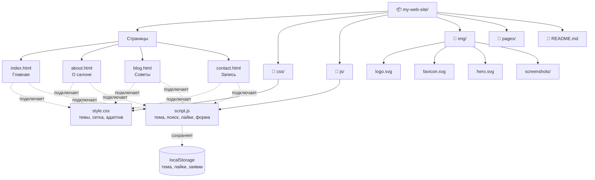

# 🐾 Груминг-салон «Пушистый друг»

## Описание

Учебный статический сайт груминг-салона для собак на чистом **HTML5**, **CSS3** и **JavaScript** без фреймворков и сборщиков. На сайте можно посмотреть услуги и цены, прочитать советы по уходу за питомцем и оставить заявку на запись. Код хранится в Git, сайт опубликован на GitHub Pages.

## 🚀 Функциональность

- [x] Адаптивный дизайн (Mobile First: телефон, планшет, десктоп)
- [x] Тёмная/светлая тема (выбор запоминается, учитывается системная настройка)
- [x] Навигация между страницами с подсветкой активной ссылки и мобильным меню
- [x] Поиск по контенту (новости на главной и советы в блоге)
- [x] JS-эффекты: печатающийся заголовок, плавное появление блоков при прокрутке, анимированные счётчики, кнопка «Наверх»
- [x] localStorage: тема, счётчик посещений, лайки к советам, черновик и список заявок на запись

## 📁 Структура проекта

```
my-web-site/
├── index.html        # Главная: hero, статистика, услуги и цены, быстрые ссылки, новости
├── about.html        # О салоне: описание, цели, команда, история
├── blog.html         # Советы по уходу: статьи с поиском и лайками
├── contact.html      # Контакты и форма записи на груминг
├── css/
│   └── style.css     # Все стили, переменные тем, media queries
├── js/
│   └── script.js     # Тема, меню, поиск, лайки, форма, эффекты
├── img/
│   ├── logo.svg
│   ├── favicon.svg
│   ├── hero.svg
│   └── screenshots/
├── pages/            # Дополнительные страницы (при необходимости)
└── README.md
```

### Диаграмма структуры



## 🌐 GitHub Pages

Сайт доступен по адресу: https://archicff.github.io/grumings_salon/

## 👥 Разработчики

- Артём Г. — разработчик и автор проекта

## 📄 Лицензия

MIT
